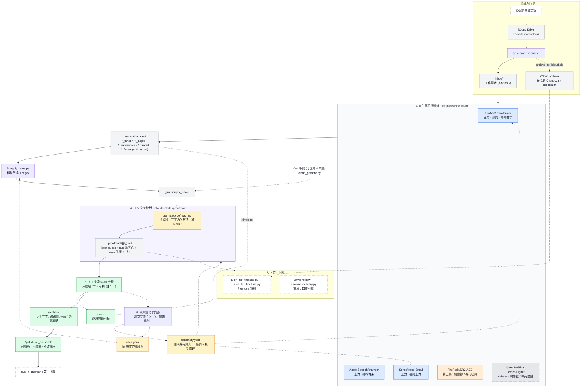
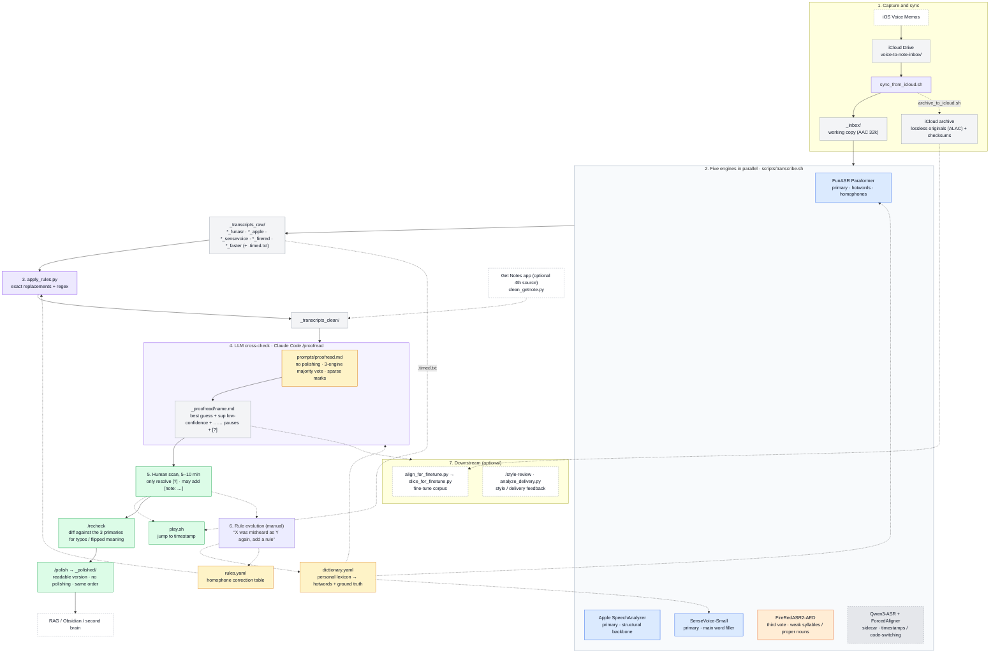

<div align="center">

# Voice-to-Note

**把口語錄音變成「不潤稿」的逐字稿：五個本地 ASR 引擎並跑、LLM 交叉校對、人只看 0–2 個問號。**

**Turn spoken recordings into faithful, un-polished transcripts: five local ASR engines in parallel, LLM cross-checking, and a human who only has to look at 0–2 question marks.**


[繁體中文](#繁體中文) · [English](#english)

</div>

---

## 繁體中文

### 這是什麼

Voice-to-Note 是一套跑在 Apple Silicon Mac 上的個人工作流：把 iOS 語音備忘錄裡的中文口語自述，轉成校對過、但**刻意不潤稿**的逐字稿，作為長期知識庫（RAG / Obsidian）的素材。

它解決的不是「轉錄準確率」這個問題，而是**「人的校對成本」**：單一引擎永遠有崩的段落，但五個引擎很少在同一個地方一起崩。多引擎多數決把 best-guess 直接填好，只把真正兩可的地方用幾乎看不見的標記留給人耳，讓一份 50 分鐘的錄音 5–10 分鐘就能掃完。

### 設計理念

- **不潤稿。** 口語的重複、繞、停頓、語氣詞（嗯、欸、就是、然後）全部保留，那是素材的一部分，不是雜訊。
- **沒有單一引擎夠好，所以分工。** 三個主力引擎做多數決，一個第三票專撈弱音節與陌生專有名詞，一個 sidecar 負責時間戳與中英混講備援。
- **標記要稀疏。** 低信心用 `<sup>字？</sup>`（視覺上幾乎看不到）、真實停頓用 `……`、嚴重分歧用 `[？]`。一份稿子 `[？]` 通常 0–2 個，滿眼問號就代表 prompt 沒貫徹。
- **人在迴路，但不當苦工。** 人只處理 `[？]`，想回聽就用時間戳跳播，改完的字回饋成規則，下一次就不會再錯。
- **規則會演化。** 專有名詞進 `dictionary.yaml`（當熱詞餵給引擎），同音錯字進 `rules.yaml`（精確替換 + regex），久了就是你個人的語言指紋。
- **全程本地、手動觸發。** 沒有雲端 ASR，沒有 cron；音檔與逐字稿不離開自己的機器與 iCloud。

### 架構圖



實線是主流程，虛線是可選 / 回饋路徑。藍色是參與多數決的三主力，橘色是補詞第三票，灰色虛框是不算票的 sidecar，黃色是會隨時間演化的個人設定檔，綠色是人做的事。

### 引擎角色分工

| 引擎 | 模型 | 角色 | 輸出 | 特性 |
|---|---|---|---|---|
| **FunASR** | Paraformer-zh (SeACo) + fsmn-vad + ct-punc（ModelScope） | 主力：補詞、修同音字 | `_funasr.txt` | 唯一吃熱詞（`dictionary.yaml`）；自帶標點；輸出簡轉繁；Apple Silicon 走 MPS，56 分鐘音檔約 30 秒 |
| **Apple SpeechAnalyzer** | macOS 26+ 內建 zh-TW 模型 | 主力：結構骨架 | `_apple.txt` | 跟 iOS 語音備忘錄同一顆引擎；標點斷句最穩、CER 最低；50 分鐘約 15–30 秒 |
| **SenseVoice** | `iic/SenseVoiceSmall` | 主力：補詞主力 | `_sensevoice.txt` | 自帶標點、句末斷行；長檔零崩；可當第二骨架對照 |
| **FireRedASR2-AED** | `mlx-community/FireRedASR2-AED-mlx` | 補詞第三票 | `_firered.txt` + `.timed.txt` + `.conf.jsonl` | 弱音節 / 陌生專有名詞常是唯一對的引擎；無標點無熱詞；50 秒切片；最慢（約 5.5× 即時）；失敗不擋主流程 |
| **Qwen3-ASR + ForcedAligner** | `mlx-community/Qwen3-ASR-1.7B-8bit` + `Qwen3-ForcedAligner-0.6B-8bit` | sidecar（不算票） | `_faster.txt` + `_faster.timed.txt` | 逐字對齊取句首的時間戳；中英混講時唯一會把整句英文吐出來；約 30× 即時；`SIDECAR_ENGINE=whisper` 可切回舊的 mlx-whisper turbo |
| Get 筆記（可選） | 外部 App，經 MCP 取得 | 第 4 來源 tie-breaker | `_getnote.txt` + `.timed.txt` | 只在主力有輕微歧異時參考；音檔品質差時完全不參與（AI 補完幻覺會污染知識庫） |

**多數決規則**（完整版在 [`prompts/proofread.md`](prompts/proofread.md)）：三主力一致直接填；兩票對一票用多數決；Apple 獨家但語意明顯對就用 Apple；主力有歧異看 FireRed；三主力全崩優先用 FireRed 的版本；sidecar 只在中英混講 / 英文專名處查。`dictionary.yaml` 收錄的專有名詞永遠以詞典為準。

### 標記系統

校對稿要「視覺上滿眼乾淨」。只有三種標記，而且都很輕：

| 標記 | 意思 | 頻率 |
|---|---|---|
| 一般文字 | 多數決的 best-guess，直接填、不標 | 絕大多數 |
| `<sup>字？</sup>` | 低信心：單引擎孤證、引擎互相矛盾、讀起來有點怪 | 一份稿 0–8 個 |
| `……` | 真實停頓：講卡、情緒來了、話題跳、長空檔。是節奏，不是錯誤 | 視內容 |
| `[？]` + 文末斜體說明 | 嚴重語意分歧、陌生專有名詞、或三主力 + FireRed 全崩只剩單一可疑來源 | 一份稿 0–2 個 |
| `[註：…]` | 使用者事後手動補的旁註。Claude 只讀不寫、不改、不刪 | 使用者決定 |

### 目錄結構

```
voice-to-note/
├── _inbox/                  音檔工作副本(AAC 回聽版;無損原檔在 iCloud archive)   [不入版控]
├── _transcripts_raw/        五引擎原始輸出 + .timed.txt 時間戳                       [不入版控]
├── _transcripts_clean/      套過 rules.yaml 的版本                                    [不入版控]
├── _proofread/              LLM 校對稿,每份音檔一個 .md ★ 人要讀的就是這個 ★         [不入版控]
├── _polished/               /polish 產出的可讀版                                     [不入版控]
├── _alignment/ _corpus_raw/ fine-tune 對齊清單與切片語料                             [不入版控]
│
├── dictionary.yaml          個人專有詞典(熱詞 + 校對真理)   ← 從 dictionary.example.yaml 複製 [不入版控]
├── rules.yaml               同音錯字對照表                  ← 從 rules.example.yaml 複製      [不入版控]
├── prompts/proofread.md     LLM 校對 prompt(不潤稿、多數決、標記原則)
├── CLAUDE.md                專案指引:Claude Code 讀了就知道整套流程怎麼跑
├── .claude/commands/        /proofread /recheck /polish /style-review 四個 slash command
├── .claude/workflows/       /style-review 用的多 agent 工作流
├── docs/finetune_plan.md    fine-tune 路線規劃
│
└── scripts/
    ├── transcribe.sh                    主入口:五引擎並跑 + sidecar 逾時 watchdog
    ├── transcribe_funasr.sh             FunASR(熱詞、簡轉繁、MPS)
    ├── transcribe-apple.swift           Apple SpeechAnalyzer(macOS 26+)
    ├── transcribe_sensevoice.py         SenseVoice-Small
    ├── transcribe_firered.py            FireRedASR2-AED(MLX,含 K/V 快取加速 patch)
    ├── transcribe_qwen3.py              Qwen3-ASR + ForcedAligner sidecar
    ├── transcribe_faster_whisper*.{sh,py}  舊 sidecar:mlx-whisper turbo(SIDECAR_ENGINE=whisper)
    ├── modelscope_local.py              ModelScope 掛掉時的離線 fallback
    ├── apply_rules.py                   套 rules.yaml
    ├── clean_getnote.py                 清洗 Get 筆記匯出(去說話人/時間戳/幻覺 + 簡轉繁)
    ├── merge_transcripts.py             多引擎字元級 diff
    ├── flag_low_confidence.py           whisper 信心分數 → 低信心段清單
    ├── play.sh                          從時間戳跳播音檔(mpv / ffplay)
    ├── process_inbox.sh                 批次:掃 _inbox 未處理的檔 → 轉錄 + 套規則
    ├── sync_from_icloud.sh / archive_to_icloud.sh / compress_inbox.sh / icloud_archive.sh
    │                                    iCloud 收件、無損封存(checksum)、壓縮回聽版、釋放空間
    ├── align_for_finetune.py / slice_for_finetune.py / review_corpus.py
    │                                    校對稿貼回時間戳 → 切 5–15s 語料 → 人耳抽驗
    ├── merge_yating.py / strip_proofread_speaker.py   多人對話(diarization)輔助
    └── analyze_delivery.py              口條指標(填充詞頻率等)
```

### 安裝

**硬體 / 系統**

- Apple Silicon Mac。Apple SpeechAnalyzer 需要 **macOS 26+**，MLX 引擎需要 Apple Silicon。實測環境：macOS 27.2、M4 Pro、Swift 6.4、Python 3.12。
- 磁碟空間：模型第一次執行會自動下載，合計約 8–9 GB。

**工具與套件**

```bash
# Homebrew 工具
brew install ffmpeg mpv          # mpv 可換 ffplay(ffmpeg 附帶)

# Python 套件(實測版本:funasr 1.3.1 / modelscope 1.35.3 / torch 2.11 / mlx 0.31 / mlx-audio 0.4.4)
pip install funasr modelscope torch torchaudio opencc-python-reimplemented pyyaml numpy mlx-audio
pip install mlx-whisper          # 可選:只有 SIDECAR_ENGINE=whisper 才用得到

# 個人設定檔(不入版控,從範本複製後自己填)
cp dictionary.example.yaml dictionary.yaml
cp rules.example.yaml rules.yaml
mkdir -p _inbox _transcripts_raw _transcripts_clean _proofread _polished
```

**模型（首次執行自動下載）**

| 引擎 | 模型 | 來源 | 大小 |
|---|---|---|---|
| FunASR | `paraformer-zh`、`fsmn-vad`、`ct-punc` | ModelScope | 約 1 GB |
| SenseVoice | `iic/SenseVoiceSmall` | ModelScope | 約 900 MB |
| FireRedASR2 | `mlx-community/FireRedASR2-AED-mlx` | Hugging Face | 約 4.5 GB |
| Qwen3 sidecar | `mlx-community/Qwen3-ASR-1.7B-8bit` + `Qwen3-ForcedAligner-0.6B-8bit` | Hugging Face | 約 2 GB + 0.7 GB |
| Apple | zh-TW 語音模型 | macOS 系統 | 數百 MB |

ModelScope 偶爾當機（502）。`scripts/modelscope_local.py` 會在模型已快取時直接走本地路徑，不碰網路。

**LLM 校對步驟**

校對不是一支腳本，而是由 [Claude Code](https://claude.com/claude-code) 讀 `CLAUDE.md` 與 `prompts/proofread.md` 後，同時讀所有 clean 稿交叉比對完成。四個 slash command 定義在 `.claude/commands/`。要用別的 LLM 也可以：prompt 本身就在 `prompts/proofread.md`。

### 日常使用

**1. 收音檔**

iPhone / iPad 錄完，捷徑或手動存到 iCloud Drive 的 `voice-to-note-inbox/`，然後：

```bash
./scripts/sync_from_icloud.sh      # 搬進 _inbox/,同時複製一份無損原檔到 iCloud archive(checksum 驗證)
```

或直接把 `.m4a` / `.mp3` / `.wav` 丟進 `_inbox/`。

**2. 轉錄 + 校對**

在專案目錄打開 Claude Code：

```
/proofread 2026-09-27-1530
/proofread 2026-09-27-1530 9月27日讀書會心得      ← 後面接 Get 筆記標題就會拉進第 4 來源
```

等 10–15 分鐘（九成時間是引擎在跑），校對稿出現在 `_proofread/2026-09-27-1530.md`，只有這一個檔。

不用 Claude Code 也能跑前半段：

```bash
./scripts/transcribe.sh _inbox/2026-09-27-1530.m4a        # 五引擎並跑
for f in _transcripts_raw/2026-09-27-1530_*.txt; do python3 scripts/apply_rules.py "$f"; done
./scripts/process_inbox.sh                                 # 或:批次處理 _inbox 裡所有未處理的檔
```

**3. 掃讀**

像讀一篇文章一樣掃過去，覺得順就往下，只在 `[？]` 停。想回聽某段：

```bash
./scripts/play.sh 2026-09-27-1530 28:05      # 時間戳查 _transcripts_raw/<檔名>_faster.timed.txt
```

改完直接存檔。想加旁註就寫 `[註：…]`，Claude 之後不會動它。

**4. 複查與潤讀**

```
/recheck            比對三主力原稿,列出手改後可疑的 typo / 語意翻轉 / 漏音節,不直接改檔
/polish             產出 _polished/<檔名>.md:刪 stutter、保留語意與節奏,不潤稿、不改順序
```

**5. 讓它越用越準**

跟 Claude 說「這次又錯了 X→Y，加進規則」，它會判斷該進 `dictionary.yaml`（專有名詞）、`rules.yaml` 的 `simple_replacements`（無歧義同音字）還是 `context_replacements`（有歧義、要 regex 限定上下文）。

### 這個 repo 裡沒有的東西

音檔、所有逐字稿、校對稿、潤讀稿、個人詞典與規則、以及分析自私人錄音的文件都在 `.gitignore` 裡，只存在本機與 iCloud。repo 裡只有 pipeline：腳本、prompt、slash command、工作流定義，以及兩個範本設定檔。

### 進一步閱讀

- [`CLAUDE.md`](CLAUDE.md) — 完整工作流規格：每個資料夾、每個引擎的角色、校對的不可違反原則
- [`prompts/proofread.md`](prompts/proofread.md) — 校對 prompt 本體與標記原則
- [`.claude/commands/`](.claude/commands/) — `/proofread`、`/recheck`、`/polish`、`/style-review`
- [`docs/finetune_plan.md`](docs/finetune_plan.md) — 用自己的校對稿 fine-tune ASR 的路線

---

## English

### What it is

Voice-to-Note is a personal workflow that runs on an Apple Silicon Mac. It takes spoken Mandarin recordings from iOS Voice Memos and turns them into proofread, but **deliberately un-polished**, transcripts that feed a long-term knowledge base (RAG / Obsidian).

The problem it solves is not transcription accuracy. It is **the human cost of proofreading**. Any single engine has passages where it falls apart, but five engines rarely fall apart in the same place. A multi-engine majority vote fills in the best guess directly, and only the genuinely ambiguous spots are left for a human ear, marked so lightly you barely see them. A 50-minute recording takes 5–10 minutes to scan.

### Design principles

- **No polishing.** Repetitions, detours, pauses and filler words are kept. They are part of the material, not noise.
- **No single engine is good enough, so give them roles.** Three primary engines vote, a third-vote engine specialises in weak syllables and unfamiliar proper nouns, and a sidecar provides timestamps and a fallback for code-switched English.
- **Marks must be sparse.** Low confidence uses `<sup>word?</sup>` (nearly invisible), real pauses use `……`, and serious disagreements use `[?]`. A transcript typically has 0–2 `[?]` marks. A page full of question marks means the prompt was not followed.
- **Human in the loop, but never a drudge.** The human only handles `[?]`, jumps to a timestamp to re-listen, and feeds corrections back as rules so the same mistake never recurs.
- **Rules evolve.** Proper nouns go into `dictionary.yaml` (fed to the engines as hotwords), homophone errors go into `rules.yaml` (exact replacements plus regex). Over time it becomes your personal linguistic fingerprint.
- **Fully local, manually triggered.** No cloud ASR, no cron. Audio and transcripts never leave your machine and your iCloud.

### Architecture



Solid arrows are the main path, dashed arrows are optional or feedback paths. Blue nodes are the three voting primaries, orange is the third vote, the grey dashed node is the non-voting sidecar, yellow nodes are the personal config files that evolve over time, and green nodes are the human's work.

### Engine roles

| Engine | Model | Role | Output | Notes |
|---|---|---|---|---|
| **FunASR** | Paraformer-zh (SeACo) + fsmn-vad + ct-punc (ModelScope) | Primary: fill words, fix homophones | `_funasr.txt` | The only engine that takes hotwords from `dictionary.yaml`; punctuation built in; Simplified → Traditional conversion; runs on MPS, about 30 s for a 56-minute file |
| **Apple SpeechAnalyzer** | Built-in zh-TW model, macOS 26+ | Primary: structural backbone | `_apple.txt` | Same engine as iOS Voice Memos; most stable punctuation and sentence breaks, lowest CER; 15–30 s for 50 minutes |
| **SenseVoice** | `iic/SenseVoiceSmall` | Primary: main word filler | `_sensevoice.txt` | Punctuation and line breaks built in; never collapses on long files; usable as a second backbone |
| **FireRedASR2-AED** | `mlx-community/FireRedASR2-AED-mlx` | Third vote for word filling | `_firered.txt` + `.timed.txt` + `.conf.jsonl` | Often the only engine that gets weak syllables and unfamiliar proper nouns right; no punctuation, no hotwords; 50-second chunks; slowest (about 5.5× real time); failure does not block the pipeline |
| **Qwen3-ASR + ForcedAligner** | `mlx-community/Qwen3-ASR-1.7B-8bit` + `Qwen3-ForcedAligner-0.6B-8bit` | Sidecar (does not vote) | `_faster.txt` + `_faster.timed.txt` | Sentence-level timestamps from word-level alignment; the only engine that outputs whole English sentences in code-switched speech; about 30× real time; `SIDECAR_ENGINE=whisper` switches back to the older mlx-whisper turbo |
| Get Notes (optional) | External app, fetched over MCP | 4th-source tie-breaker | `_getnote.txt` + `.timed.txt` | Consulted only when the primaries mildly disagree; excluded entirely when audio quality is poor, because its AI completion hallucinates plausible text |

**Voting rules** (full version in [`prompts/proofread.md`](prompts/proofread.md)): if all three primaries agree, fill it in; two against one, majority wins; Apple alone but clearly right, use Apple; when primaries disagree, consult FireRed; when all three primaries collapse, prefer FireRed's version; the sidecar is only consulted for code-switched English and English proper nouns. Proper nouns listed in `dictionary.yaml` always win.

### Marking system

The proofread transcript should look clean at a glance. There are only three kinds of marks, all light:

| Mark | Meaning | Frequency |
|---|---|---|
| plain text | Majority-vote best guess, filled in without a mark | almost everything |
| `<sup>word?</sup>` | Low confidence: a single engine's lone reading, engines contradict each other, or it reads slightly off | 0–8 per transcript |
| `……` | A real pause: getting stuck, emotion rising, a topic jump, a long silence. Rhythm, not an error | depends on content |
| `[?]` + an italic note at the end | Serious semantic disagreement, an unknown proper noun, or all three primaries plus FireRed collapsed leaving a single dubious source | 0–2 per transcript |
| `[note: …]` | A side note the user adds by hand afterwards. Claude reads it but never writes, edits or deletes it | user's call |

### Directory layout

```
voice-to-note/
├── _inbox/                  working copies of audio (AAC; lossless originals live in the iCloud archive)  [git-ignored]
├── _transcripts_raw/        raw output of the five engines + .timed.txt timestamps                          [git-ignored]
├── _transcripts_clean/      after rules.yaml                                                                [git-ignored]
├── _proofread/              LLM-proofread transcript, one .md per recording ★ this is what you read ★       [git-ignored]
├── _polished/               readable versions from /polish                                                  [git-ignored]
├── _alignment/ _corpus_raw/ fine-tune alignment lists and sliced corpus                                     [git-ignored]
│
├── dictionary.yaml          personal lexicon (hotwords + ground truth)   ← copy from dictionary.example.yaml [git-ignored]
├── rules.yaml               homophone correction table                   ← copy from rules.example.yaml      [git-ignored]
├── prompts/proofread.md     the LLM proofreading prompt (no polishing, majority vote, marking rules)
├── CLAUDE.md                project guide: Claude Code reads this and knows how to run the whole pipeline
├── .claude/commands/        the /proofread /recheck /polish /style-review slash commands
├── .claude/workflows/       multi-agent workflow behind /style-review
├── docs/finetune_plan.md    fine-tuning roadmap
│
└── scripts/
    ├── transcribe.sh                    entry point: five engines in parallel + sidecar timeout watchdog
    ├── transcribe_funasr.sh             FunASR (hotwords, Simplified→Traditional, MPS)
    ├── transcribe-apple.swift           Apple SpeechAnalyzer (macOS 26+)
    ├── transcribe_sensevoice.py         SenseVoice-Small
    ├── transcribe_firered.py            FireRedASR2-AED on MLX (with a K/V-cache speed patch)
    ├── transcribe_qwen3.py              Qwen3-ASR + ForcedAligner sidecar
    ├── transcribe_faster_whisper*.{sh,py}  legacy sidecar: mlx-whisper turbo (SIDECAR_ENGINE=whisper)
    ├── modelscope_local.py              offline fallback when ModelScope is down
    ├── apply_rules.py                   apply rules.yaml
    ├── clean_getnote.py                 clean a Get Notes export (speaker tags, timestamps, hallucinations, Simplified→Traditional)
    ├── merge_transcripts.py             character-level diff across engines
    ├── flag_low_confidence.py           whisper confidence scores → list of low-confidence segments
    ├── play.sh                          play audio from a timestamp (mpv / ffplay)
    ├── process_inbox.sh                 batch: transcribe + apply rules for every unprocessed file in _inbox
    ├── sync_from_icloud.sh / archive_to_icloud.sh / compress_inbox.sh / icloud_archive.sh
    │                                    iCloud intake, lossless archive with checksums, compressed listening copies, evict local copies
    ├── align_for_finetune.py / slice_for_finetune.py / review_corpus.py
    │                                    align proofread text to timestamps → slice 5–15 s clips → listen-and-verify sample
    ├── merge_yating.py / strip_proofread_speaker.py   helpers for multi-speaker (diarised) conversations
    └── analyze_delivery.py              delivery metrics (filler-word rates and so on)
```

### Installation

**Hardware and OS**

- An Apple Silicon Mac. Apple SpeechAnalyzer needs **macOS 26 or later**, and the MLX engines need Apple Silicon. Tested on macOS 27.2, M4 Pro, Swift 6.4, Python 3.12.
- Disk: models download automatically on first run, about 8–9 GB in total.

**Tools and packages**

```bash
# Homebrew tools
brew install ffmpeg mpv          # ffplay (bundled with ffmpeg) works instead of mpv

# Python packages (tested with funasr 1.3.1 / modelscope 1.35.3 / torch 2.11 / mlx 0.31 / mlx-audio 0.4.4)
pip install funasr modelscope torch torchaudio opencc-python-reimplemented pyyaml numpy mlx-audio
pip install mlx-whisper          # optional: only used with SIDECAR_ENGINE=whisper

# Personal config files (git-ignored; copy the templates and fill in your own entries)
cp dictionary.example.yaml dictionary.yaml
cp rules.example.yaml rules.yaml
mkdir -p _inbox _transcripts_raw _transcripts_clean _proofread _polished
```

**Models (downloaded automatically on first run)**

| Engine | Model | Source | Size |
|---|---|---|---|
| FunASR | `paraformer-zh`, `fsmn-vad`, `ct-punc` | ModelScope | about 1 GB |
| SenseVoice | `iic/SenseVoiceSmall` | ModelScope | about 900 MB |
| FireRedASR2 | `mlx-community/FireRedASR2-AED-mlx` | Hugging Face | about 4.5 GB |
| Qwen3 sidecar | `mlx-community/Qwen3-ASR-1.7B-8bit` + `Qwen3-ForcedAligner-0.6B-8bit` | Hugging Face | about 2 GB + 0.7 GB |
| Apple | zh-TW speech model | macOS system asset | a few hundred MB |

ModelScope goes down now and then (HTTP 502). `scripts/modelscope_local.py` uses the local cache path directly whenever a model is already cached, without touching the network.

**The LLM step**

Proofreading is not a script. [Claude Code](https://claude.com/claude-code) reads `CLAUDE.md` and `prompts/proofread.md`, then reads every cleaned transcript at once and cross-checks them. The four slash commands are defined in `.claude/commands/`. Any other LLM can do the same job: the prompt itself lives in `prompts/proofread.md`.

### Daily use

**1. Bring in audio**

Record on iPhone or iPad, save to `voice-to-note-inbox/` on iCloud Drive (a Shortcut or by hand), then:

```bash
./scripts/sync_from_icloud.sh      # move into _inbox/ and copy a lossless original to the iCloud archive with checksum verification
```

Or drop `.m4a` / `.mp3` / `.wav` files straight into `_inbox/`.

**2. Transcribe and proofread**

Open Claude Code in the project directory:

```
/proofread 2026-09-27-1530
/proofread 2026-09-27-1530 Sep 27 book club notes     ← a Get Notes title after the name pulls in the 4th source
```

Wait 10–15 minutes (most of it is the engines running). The transcript appears at `_proofread/2026-09-27-1530.md`, and that is the only file.

The first half also runs without Claude Code:

```bash
./scripts/transcribe.sh _inbox/2026-09-27-1530.m4a        # five engines in parallel
for f in _transcripts_raw/2026-09-27-1530_*.txt; do python3 scripts/apply_rules.py "$f"; done
./scripts/process_inbox.sh                                 # or: batch every unprocessed file in _inbox
```

**3. Scan**

Read it like an article. Keep going while it flows, stop only at `[?]`. To re-listen to a passage:

```bash
./scripts/play.sh 2026-09-27-1530 28:05      # find timestamps in _transcripts_raw/<name>_faster.timed.txt
```

Edit and save. Add `[note: …]` for side notes; Claude will leave them alone.

**4. Re-check and polish**

```
/recheck            diff your edited transcript against the three primaries, list suspicious typos / flipped meanings / dropped syllables, without editing
/polish             write _polished/<name>.md: drop stutters, keep meaning and rhythm, no polishing, no reordering
```

**5. Make it more accurate over time**

Tell Claude "X was misheard as Y again, add a rule". It decides whether the fix belongs in `dictionary.yaml` (proper nouns), `simple_replacements` in `rules.yaml` (unambiguous homophones) or `context_replacements` (ambiguous ones that need a regex to pin down context).

### What is not in this repo

Audio, every transcript, proofread and polished text, the personal lexicon and rules, and documents analysed from private recordings are all in `.gitignore`. They exist only on the local machine and in iCloud. The repo holds the pipeline only: scripts, prompt, slash commands, workflow definitions and two template config files.

### Further reading

- [`CLAUDE.md`](CLAUDE.md) — the full workflow spec: every folder, every engine's role, the proofreading rules that must not be broken (Traditional Chinese)
- [`prompts/proofread.md`](prompts/proofread.md) — the proofreading prompt and marking rules (Traditional Chinese)
- [`.claude/commands/`](.claude/commands/) — `/proofread`, `/recheck`, `/polish`, `/style-review`
- [`docs/finetune_plan.md`](docs/finetune_plan.md) — roadmap for fine-tuning ASR on your own proofread transcripts
